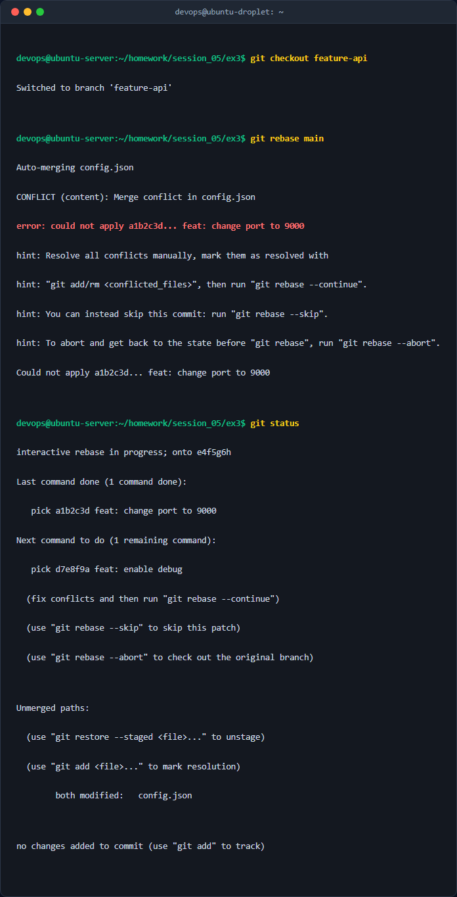
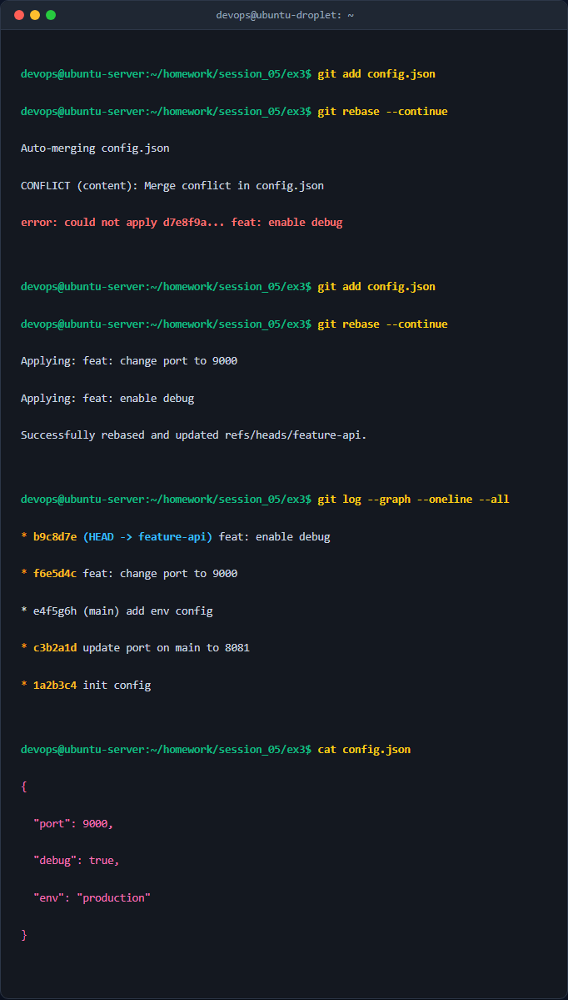

# Báo cáo Kỹ thuật: Xử lý xung đột phức tạp trong quá trình Rebase trên Git

## 1. Mục tiêu & Bối cảnh kỹ thuật

### 1.1. Mục tiêu
- Nắm vững bản chất cơ chế hoạt động của `git rebase` so với `git merge` trong việc duy trì lịch sử cam kết (commit history) dạng tuyến tính (linear history).
- Thực hành quy trình giải quyết xung đột từng bước (step-by-step conflict resolution) khi thực hiện rebase nhánh tính năng (`feature-api`) lên đỉnh của nhánh chính (`main`).
- Đảm bảo tính toàn vẹn của mã nguồn và cấu hình hệ thống sau khi giải quyết các xung đột phát sinh ở nhiều commit liên tiếp.

### 1.2. Bối cảnh kỹ thuật
- **Hệ thống cấu hình:** File `config.json` và lớp Java nạp cấu hình `AppConfig.java` trong kiến trúc Microservices Java/Spring Boot.
- **Nhánh `main`:** Có 2 commit mới do thành viên khác cập nhật cổng dịch vụ (`"port": 8081`) và bổ sung trường môi trường (`"env": "production"`).
- **Nhánh `feature-api`:** Được phân nhánh từ commit khởi tạo của `main`, sau đó có 2 commit độc lập sửa đổi cùng tệp tin `config.json` (`"port": 9000` và `"debug": true`).
- **Vấn đề phát sinh:** Khi thực hiện `git rebase main` từ nhánh `feature-api`, Git sẽ tua lại các commit của `feature-api` về điểm phân nhánh chung, áp dụng lần lượt các commit mới của `main`, sau đó áp dụng từng commit của `feature-api` lên trên đỉnh. Xung đột sẽ xảy ra tuần tự tại từng chặng commit và đòi hỏi kỹ sư phải can thiệp thủ công.

---

## 2. Các bước thực hiện chi tiết

### Bước 1: Thiết lập môi trường và cấu hình ban đầu trên nhánh main
Khởi tạo kho chứa và tạo tệp cấu hình ban đầu:
```bash
mkdir -p homework/session_05/ex3
cd homework/session_05/ex3
git init
```

Tạo tệp `config.json` với nội dung ban đầu:
```json
{
  "port": 8080,
  "debug": false
}
```

Thực hiện commit khởi tạo trên nhánh `main`:
```bash
git add config.json
git commit -m "init config"
```
*Giải thích:* Lệnh `git add` đưa file vào staging area; `git commit -m` ghi nhận snapshot đầu tiên với thông điệp rõ ràng.

### Bước 2: Tạo nhánh tính năng feature-api và tạo 2 commit phát triển
Tạo và chuyển sang nhánh `feature-api`:
```bash
git checkout -b feature-api
```
*Giải thích:* Cờ `-b` giúp tạo nhánh mới và chuyển ngay con trỏ `HEAD` sang nhánh đó.

**Commit 1 trên feature-api:** Sửa `"port": 9000` trong `config.json`:
```json
{
  "port": 9000,
  "debug": false
}
```
Thực hiện commit:
```bash
git add config.json
git commit -m "feat: change port to 9000"
```

**Commit 2 trên feature-api:** Sửa `"debug": true` trong `config.json`:
```json
{
  "port": 9000,
  "debug": true
}
```
Thực hiện commit:
```bash
git add config.json
git commit -m "feat: enable debug"
```

### Bước 3: Cập nhật nhánh main với 2 commit mới
Quay trở lại nhánh `main`:
```bash
git checkout main
```

**Commit 1 trên main:** Sửa `"port": 8081` trong `config.json`:
```json
{
  "port": 8081,
  "debug": false
}
```
Thực hiện commit:
```bash
git add config.json
git commit -m "update port on main to 8081"
```

**Commit 2 trên main:** Thêm cấu hình `"env": "production"` vào `config.json`:
```json
{
  "port": 8081,
  "debug": false,
  "env": "production"
}
```
Thực hiện commit:
```bash
git add config.json
git commit -m "add env config"
```

### Bước 4: Thực hiện Rebase và xử lý xung đột từng bước (Step-by-Step Resolution)

Chuyển về nhánh `feature-api` và bắt đầu Rebase:
```bash
git checkout feature-api
git rebase main
```

#### Xử lý xung đột Chặng 1 (Áp dụng commit `feat: change port to 9000`):
Git thông báo xung đột tại tệp `config.json`. Trạng thái Git rơi vào trạng thái `REBASE 1/2`.

Kiểm tra trạng thái:
```bash
git status
```

Nội dung xung đột trong `config.json` xuất hiện conflict markers:
```json
{
<<<<<<< HEAD
  "port": 8081,
  "debug": false,
  "env": "production"
=======
  "port": 9000,
  "debug": false
>>>>>>> feat: change port to 9000
}
```

*Phân tích & Xử lý:* Phía nhánh tính năng cần port `9000`, đồng thời phải giữ nguyên thuộc tính mới `"env": "production"` từ `main`. Chỉnh sửa thủ công nội dung file `config.json` thành:
```json
{
  "port": 9000,
  "debug": false,
  "env": "production"
}
```

Đánh dấu đã xử lý và tiếp tục chu trình Rebase:
```bash
git add config.json
git rebase --continue
```

#### Xử lý xung đột Chặng 2 (Áp dụng commit `feat: enable debug`):
Git áp dụng commit tiếp theo và tiếp tục báo xung đột do cấu trúc tệp đã có thuộc tính `env` và `debug` thay đổi.

Nội dung xung đột trong `config.json`:
```json
{
<<<<<<< HEAD
  "port": 9000,
  "debug": false,
  "env": "production"
=======
  "port": 9000,
  "debug": true
>>>>>>> feat: enable debug
}
```

*Phân tích & Xử lý:* Giữ giá trị `"debug": true` theo mục đích của commit tính năng, đồng thời giữ đầy đủ `"port": 9000` và `"env": "production"`. Chỉnh sửa file `config.json` thành:
```json
{
  "port": 9000,
  "debug": true,
  "env": "production"
}
```

Đánh dấu giải quyết và hoàn tất Rebase:
```bash
git add config.json
git rebase --continue
```

Git xuất thông báo hoàn tất: `Successfully rebased and updated refs/heads/feature-api`.

---

## 3. Kiểm tra & Xác thực kết quả

### 3.1. Kiểm tra trạng thái Git trong quá trình Rebase
Tại thời điểm phát sinh xung đột, lệnh `git status` ghi nhận trạng thái rebase đang diễn ra:



### 3.2. Kiểm tra lịch sử Git sau khi Rebase hoàn tất
Sử dụng lệnh kiểm tra đồ thị commit:
```bash
git log --graph --oneline --all
```

Kết quả hiển thị một đường thẳng tuyến tính hoàn chỉnh, không có commit rẽ nhánh hoặc merge commit dư thừa:



### 3.3. Kiểm tra tính toàn vẹn nội dung file `config.json`
```bash
cat config.json
```
Kết quả trả về chính xác cấu hình hợp nhất:
```json
{
  "port": 9000,
  "debug": true,
  "env": "production"
}
```

---

## 4. Kết luận & Best Practices bảo mật và vận hành

### 4.1. So sánh Rebase vs Merge
- **Git Merge:** Giữ nguyên lịch sử gốc và tạo một commit merge mới nối 2 nhánh. Phù hợp khi tích hợp các pull request/nhánh lớn vào nhánh sản xuất (`main`/`release`) để lưu vết thời điểm tích hợp.
- **Git Rebase:** Tua lại và viết lại lịch sử commit, giúp đồ thị Git luôn thẳng hàng, sạch sẽ, dễ dàng áp dụng `git bisect` để dò lỗi và giảm tải việc theo dõi lịch sử commit phân nhánh phức tạp.

### 4.2. Best Practices khi vận hành Git Rebase trong môi trường Enterprise
1. **Quy tắc vàng (Golden Rule of Rebase):** Tuyệt đối KHÔNG rebase trên các nhánh dùng chung (public/shared branches) như `main`, `develop`, `staging` mà chỉ rebase trên nhánh cá nhân/nhánh tính năng (`feature/*`, `bugfix/*`).
2. **Tự động sao lưu trước khi Rebase:** Sử dụng `git branch backup-feature-api` trước khi rebase để dễ dàng phục hồi nếu giải quyết xung đột nhầm lẫn.
3. **Sử dụng Git Reflog khi có sự cố:** Nếu rebase gặp lỗi nghiêm trọng, sử dụng `git reflog` và `git reset --hard HEAD@{n}` hoặc `git rebase --abort` để quay lại trạng thái trước khi rebase.
4. **Đẩy mã nguồn an toàn sau khi Rebase:** Luôn sử dụng `git push --force-with-lease` thay vì `git push --force` để ngăn chặn việc vô tình ghi đè commit của đồng nghiệp khi họ đã đẩy mã lên cùng nhánh.